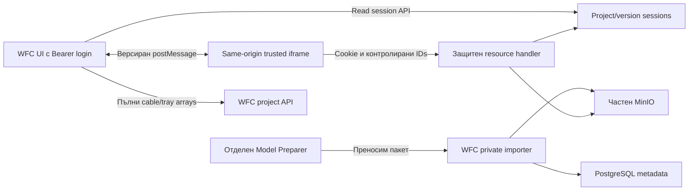

# Routings viewer във WFC — самостоятелна спецификация, етап 0

Свързани документи: [baseline и източници](00-baseline.md), [матрица на проверките](00-validation-matrix.md), [отчет и готовност](00-stage-report.md). Няма реализирана функционалност в този етап. Машинни схеми, валидатори и тестове се създават в следващи задачи.

## 1. Цел, статут и граници

Нов проектен таб **Routings viewer** показва подготвен офлайн 3D модел и маршрути от ръчен текст или `Cable.routing`. WFC управлява левия интерфейс; доверен 3D runtime работи в изолиран **same-origin iframe**. PathFinder е независим: Viewer не импортва негов код/типове/граф/библиотеки и не извиква негови услуги. Всяка система може отделно да работи с WFC.

**Изрично зададени от потребителя правила:** всички UI, independence, privacy, offline, Preparer и completion изисквания в тази спецификация; табът/подредбата; `canEditProject`; read-only Viewer достъп;1000ms panel; запазване на `Cable.routing` и SECONDARY изчисленията; етап1 без upload/conversion; browser доказване в етап5. Те са приети входни указания.

**Технически предложения, фиксирани за този документ:** ZIP layout, schema/profile, fingerprint алгоритъм, limits, idempotency, endpoint/type names, session срокове, protocol envelope, normalize/error правила и manual-empty policy. Те правят договора изпълним, но не са автоматично одобрени от потребителя. Промяна на пакетните полета/алгоритъм/profile изисква актуализация на четирите документа преди етап1. Операционните неизвестни са в §11.

Само документация е разрешена сега. Не се редактират приложения, тестове, зависимости, schema/migrations, конфигурации или Docker услуги. Не се правят моделни импорти, cloud операции, push, PR/merge. `sources/` и NWD са read-only. Ръчен маршрут не създава постоянен запис. Viewer никога не записва routing или инженерна дължина обратно в кабелите; успешното рисуване не е физическа/инженерна проверка.

Проверена основа: WFC `main@d5454b3c4c547c24631e37e24d35f76739228867`, PathFinder `master@45c24bf5f433f13e102600b36f20327c77961d0a`, локален Viewer1.3/SDK7.130.0. Пътища, timestamps, GitHub и code anchors са в baseline. Непроверена работа извън тези директории е неизвестна.

### Предложена последователност за бъдещите задачи

| Етап | Резултат/граница |
| --- | --- |
| 0 | Тези четири документа; спиране след документалния отчет |
| 1, зададен | Преносим пакет от **съществуващия** модел; без ново upload/translation; имплементиране на A schemas/packager/verifier и доказателства |
| 2, предложение | Частен импорт, PostgreSQL версии/metadata, active selection, права и package validation |
| 3, предложение | Защитени resource sessions, локален runtime и bridge; unit/API проверки |
| 4, предложение | WFC UI, independent cable/tray data, route check, Details и interaction проверки |
| 5, зададен browser scope | Реални browsers, SDK/session/worker/CSP, responsive/geometry, offline/Preparer-stopped и backup/restore acceptance |
| P, отделно предложение без определен номер | Самостоятелен Model Preparer Docker проект с fresh price0 gate, durable state и start/stop; не е разрешен за изпълнение от този документ |

Номера2–4/P са организация за матрицата, не твърдение за предишен одобрен план. Етап5 може да използва съществуващия подготвен модел при напълно спрян/отсъстващ Preparer.

## 2. Потребителски интерфейс и запазено поведение

### 2.1. Проектен таб и оформление

- В ProjectDetails редът е **Cables list → Routings viewer → Trays**. Новата tab union/validation/read-only whitelist трябва изрично да включи новия таб.
- Desktop: ляв панел320 CSSpx, моделът заема останалата ширина. WFC shell, проектното заглавие и табовете се изваждат от наличната височина; flex child с `min-height:0`, без nested viewport overflow. Няма второ основно заглавие от standalone Viewer.
- На по-малка ширина панелът може да бъде280px под900px, stacked под640px, както локалния layout; няма хоризонтално отрязване. `ResizeObserver`/iframe resize преоразмерява3D, включително при tab reveal/скрит tab/window resize.
- Левият панел съдържа **Manual routing** и **Cables**. Switching пази отделните manual text и `selectedCableId`, но не претендира, че всяко запазено поле е текущо изрисувано. Активната визуализация носи `source`/request identity.
- Light Viewer appearance остава независимо от глобалната Fluent theme. Запазват се оригинални материали/цветове, light preset7, quality(false,true), tonemap1/exposure1.0, ghost opacity0.025, continuous yellow0xffe600 overlay, съществуващи radius/render order/depth правила.
- Използва се текущият `routes.mjs`/`route-geometry.mjs` алгоритъм, включително whole-chain calibration/clipping/terminal endpoints. Не се внася друга PathFinder геометрия. Съединяващите линии през липси са визуални приближения и се отчитат в warnings.

### 2.2. Manual routing

Пазят се поле и **Show**, **Zoom**, **Clear** действия. Show изпълнява независими model и project DB проверки по договорD. Tray данните са **пълният** масив за текущия проект, не видимата страница или чужд филтър от Trays. Неуспешна заявка означава `unavailable`, не „трасето липсва“. Retry е явен; рисуването на намерените3D части не изисква успешен DB отговор.

**Точно edge поведение, предложение за интеграцията:**

| Вход/резултат | Визуализация и съобщение |
| --- | --- |
| null/empty/whitespace/само `/` | Clear стария overlay; „Въведете маршрут.“; status `empty`; Zoom disabled |
| Само SECONDARY markers | Clear; „Маршрутът съдържа само SECONDARY; няма участъци за показване.“; ignored markers се пазят в резултата |
| Няма нито едно unique name с използваема geometry | Clear; „Няма участъци, които могат да се покажат.“; individual missing/ambiguous/no_geometry/DB issues; Zoom disabled |
| Някои showable parts | Показват се всички намерени drawable части в оригиналния ред с нужните повторения; `partial` и изричен списък на пропуските/колизиите; Zoom само към показаните части |
| Всички model parts drawable, DB unavailable | Показване е възможно; „Проверката в проекта не е достъпна“; никога fully found |
| Input too long/too many/invalid normalization | Reject преди geometry; предишният overlay се изчиства, показва се конкретна validation error; text се пази за поправка |
| Clear | Отменя pending request, премахва overlay/selection/isolation, dispose resources, restore opacity; model fit както standalone; manual text остава редактиран текст, не database record |
| Zoom без active drawable route | Disabled; не се използват bounds на стар маршрут |

Standalone UI в момента задържа предишния overlay при empty/no match. Горната промяна е изрично **UI предложение**, необходимо за еднозначно обозначение на текущия опит; геометричният алгоритъм се запазва. `SECONDARY` не се проверява като tray и не се рисува; оригиналният route text не се променя.

### 2.3. Cables

- Източник е пълният project cable array чрез съществуващия list API, независимо от Cables list pagination/search/sort. При load error има retry/error state; не се показва „няма кабели“ за провалена заявка.
- Редовете показват само tag. Локален controlled input филтрира tag при всяко писане, case-insensitive substring след NFKC/trim на **search key**; няма search button. Показваният tag не се пренаписва.
- null/empty/whitespace tag се пропуска. Общото известие е „N кабела без таг не са показани“. Няма измислени `Untitled`/id означения. Duplicate tags остават отделни rows с `key=Cable.id`; `cableId` и tag не се използват като selection identity.
- Клик избира конкретния `Cable.id` и веднага заявява неговия original `routing`; няма manual retyping. Празен/null/separator-only/onlySECONDARY route изчиства предишното и показва конкретно съобщение за избрания кабел. При no drawable match също clear, за да не се показва маршрут на друг кабел.
- Последният избор печели: monotonically increasing selection/request generation; старите data/model/result/hover events са без ефект. Abort е оптимизация, identity check е задължителен дори ако abort не е изпълнен.
- Филтърът не променя избраната identity. Скрит selection може да се пази и обозначи извън списъка; не се заменя със съседен/първи tag. Delete/access loss на избрания cable изчиства selection/overlay/panel. Смяна на project изчиства всички project-bound states.
- Manual text и selected cable не се записват един в друг. Switching panel tab не променя raw `Cable.routing`. Всяко explicit show/select/clear/смяна на модел създава нов request identity.

### 2.4. Интерактивен информационен панел

Задържане върху tag row за **1000ms** отваря интерактивен panel с **From=`fromLocation`**, **To=`toLocation`**, **Routing=`routing`**. `connectedFrom`/`connectedTo` са connection dates и никога не служат за location. Empty values са „Няма стойност“, не измислен route.

- До999ms няма panel. Pointer leave/cable replacement/project change/unmount cancel timer; timeout проверява точния Cable.id, project и row generation.
- Panel и row са една hover област: pointer към panel не затваря преждевременно. Предложение:150ms grace за пресичане на междинния gap, отменен при panel enter; pinned panel няма hover close timer.
- Panel е nonmodal dialog с заглавие/tag, selectable text и controls „Copy field“, „Copy all“, „Pin/Unpin“, „Close“. Rows могат да са virtualized, но dialog е portal извън recycled rows, snapshot+identity са на Cable.id.
- Copy all използва plain text с три labeled lines в ред From/To/Routing и actual values; field copy само стойността. Clipboard API се използва когато работи; винаги има focusable selectable readonly text area/fields и „Маркирайте и натиснете Ctrl+C“. HTTP/denied clipboard има този работещ manual fallback, без фалшив „Копирано“.
- Keyboard: Enter върху row избира; focus +1000ms може да отвори panel със същия cancel behavior; Alt+Enter отваря веднага за keyboard потребител. Panel има Tab navigation; Escape/Close затваря и връща focus към същия row ако съществува, иначе към search. Escape не изтрива route.
- Pin фиксира към конкретния Cable.id и неговия project, не към DOM позиция/tag. Filter/scroll запазват тази identity. Explicit selection на друг cable или project change затваря стария panel преди отваряне на нов. Unpin възстановява hover behavior; ако pointer/focus са извън областта, close след grace.
- При data refresh същият id може да обнови показаните стойности с ясно обновяване; няма смяна към друг id. Removed cable/access loss/model tab dispose затваря panel и всички timers.

### 2.5. Details и модел

Details избира **сървърна active model version** за проекта. Предлагат се само ready/проверени версии на същия project. Change право следва `canEditProject`, а server независимо проверява същото edit capability. Read-only потребител отваря Viewer и resource session, но не импортва и не сменя active model.

Няма implicit „latest“. `activeModelVersionId=null` означава явен no-model state. Липсващи/повредени resources на избрана версия дават unavailable/error, никога fallback към друга версия. Нов пакет/версия не изисква WFC rebuild; runtime SDK остава отделно доверена версия. Старите версии и resource bytes са immutable. App version, portable package id, WFC version id и SDK version са различни понятия.

Active selection сменя model identity и `loadId`; iframe освобождава старото, route requests и panel timers се отменят. Запазеният manual text и Cable.id могат да останат в рамките на същия project; автоматично повторно показване е разрешено само като **нов** explicit-labeled loading request след `MODEL_LOADED`. Сървърният избор е authoritative: при tab focus/version conflict parent refresh-ва metadata; има явен „Моделът е сменен“ state. Едновременно отворени проекти/таби не споделят mutable load identity.

## 3. Архитектура, права и офлайн достъп



Preparer не е runtime зависимост. Viewer и PathFinder нямат стрелка помежду си. Package не задава project/права; importer назначава project според WFC авторизацията.

### 3.1. Предложени API граници

Всички IDs са UUID strings, server validates membership и current permission; path параметър никога не е storage key от клиента.

| Endpoint, предложение | Capability/отговор |
| --- | --- |
| `GET /api/projects/:projectId/model-versions` | project read; metadata без storage credentials/URL |
| `POST /api/projects/:projectId/model-imports` | project edit; streamed package;202 accepted/importId или duplicate200; не стандартния file endpoint |
| `GET /api/projects/:projectId/model-imports/:importId` | project read; прогрес/безопасни грешки |
| `PATCH /api/projects/:projectId/active-model` | project edit; `{modelVersionId: UUID|null, expectedSelectionRevision:int}`;409 при stale revision |
| `POST /api/projects/:projectId/model-versions/:modelVersionId/viewer-sessions` | **project read**, ready+active selection; body `{loadId:Uuid}`; краткотрайна cookie session;201 identity/expiry, без JWT за iframe |
| `POST .../viewer-sessions/:sessionId/renew` | project read чрез WFC Bearer; same project/version, current access; нов expiry или401/403/409/410 |
| `DELETE .../viewer-sessions/:sessionId` | project read или ownership-based revoke при отнет read; идемпотентно close |
| `POST /api/viewer-sessions/revoke-login` | authenticated login identity; revoke само resource sessions за този login, използва се при logout |
| `GET/HEAD .../viewer-sessions/:sessionId/descriptor` | същата resource cookie/current-read проверка; trusted descriptor от ready server metadata |
| `GET/HEAD .../viewer-sessions/:sessionId/resources/:resourcePath` | отделна resource cookie, per-request current project read; validated manifest path;206 Range support |

Read-only POST exception е **точен списък само за session create/renew/revoke**. Двете съществуващи gates `requireProjectReadOnly` и `requireProjectAccess` трябва да се актуализират съгласувано. Няма broad whitelist на project POST; import/active selection продължават edit-only. Basic/technician следват assignment read правилата; engineer read-all/edit-assigned; admin edit. Role/access се проверяват от DB, не само стария JWT. Непознатите API sections остават default-deny.

### 3.2. Resource session, предложение

- Създава се от WFC parent чрез съществуващото Bearer authentication. Parent генерира loadId преди create и го подава в body. Server издава opaque random secret cookie, съхранява само secret hash; session metadata: sessionId, principal/login fingerprint, projectId, modelVersionId, loadId, created/expires/absolute expiry/revokedAt. SessionId в messages/path **сам по себе си не е credential**. Create response е точно `{sessionId,projectId,modelVersionId,loadId,expiresAt,absoluteExpiresAt}`; cookie secret е само Set-Cookie.
- Cookie `wfc_viewer_session`: HttpOnly, SameSite=Strict, Path точно `/api/projects/<projectId>/model-versions/<modelVersionId>/viewer-sessions/<sessionId>/`. Един и същ cookie name с различни session paths позволява независими едновременни проекти. При HTTPS Secure; само изрично разрешен localhost/internal HTTP профил може без Secure. Secret не е в URL, postMessage, localStorage или logs.
- Предложени срокове:5min sliding expiry, parent renew преди4min; absolute30min, след което нов session+loadId и контролирано reload. Renewal изисква текущ Bearer и current read permission; не удължава стария principal/project/version. Ако основната login сесия е изтекла, няма автономно renewal от iframe.
- Session create/renew изискват same-origin Origin/fetch metadata и валидна WFC авторизация. Cookie не е общ WFC login; resource endpoint не приема основния JWT през query string. CORS за private resources не се отваря към други origins.
- При всяка GET/HEAD/Range проверка: cookie hash, срок/revocation, identity/version membership, current DB role/project access, ready/healthy version. Отнет read дава403 и revoke; expired/revoked401/410. Cache на ACL не може да позволи access след отнемане.
- Ако active model е сменен, старите resource sessions се revoke-ват;409 `MODEL_SELECTION_CHANGED` кара parent да refresh-не. Няма silent model replacement. Tab/window instance има отделен sessionId/loadId.
- Logout първо dispose local frames и revoke login-bound resource sessions, после clear основния login state. Current WFC signOut няма server revoke; това е бъдещо добавяне, без замяна на login механизма. Server acknowledgment прави revoke незабавен. При network failure локалният Viewer се освобождава, отказът се отчита; остатъчната server session не се представя като вече revoked и изтича до5min. Copy на resource URL без cookie не дава достъп.
- При401/410 runtime изпраща typed error; parent опитва най-много едно authenticated re-open/reload за текущата identity, иначе показва auth/session error. Дали SDK може да retry individual requests без reload е **неизвестно до етап5**.

Всички model resource responses, включително errors/HEAD/206/304 ако има, са първоначално **`Cache-Control: private, no-store`**, `X-Content-Type-Options:nosniff`, без public cache/CDN. Няма304 cache shortcut в initial profile. Handler определя safe content types от trusted profile. Invalid manifest path404; request с неподходящ method405; invalid/unsatisfiable Range416 с `Content-Range: bytes */<size>`; една валидна byte range →206 с correct length/content-range; multi-range reject416 вv1. HEAD проверява същите права и връща headers без body. Full GET200. Stream е ограничен до immutable object length; failure abort-ва stream, не връща SPA HTML. MinIO няма директни public или presigned URLs към browser.

Descriptor има точно `{projectId, modelVersionId, loadId, contentFingerprint, supportProfile, format, sdkVersion, entrypoint, resourceCount, totalBytes}` от session/B/A. Той е защитен със същите cookie/access/no-store правила и не съдържа arbitrary URL. Runtime първо проверява descriptor identity/profile срещу LOAD_MODEL, после resolve-ва manifest entrypoint спрямо session base: `/.../viewer-sessions/<sessionId>/` + `resources/output/0/0.svf`. Endpoint параметърът `resourcePath` е `output/0/0.svf`; handler lookup key е `resources/` + `resourcePath`. Няма удвояване `resources/resources/` и няма ползване на WFC Bearer helper от iframe. InstanceId/source проверката е bridge-bound; server session не твърди, че cookie може криптографски да различи две същ-origin windows на същия login.

### 3.3. Runtime и hosting

Довереният offline SDK/runtime се инсталира отделно, exact7.130.0, с deployment inventory/hashes. Package никога не доставя scripts/styles/workers. Няма автоматичен CDN fallback, credentialed Autodesk calls или интернет зависимост за модел/маршрут. Runtime може да се обслужва като непроектен trusted static code; всички **project model bytes** минават през protected handler.

Предложен iframe entry `/viewer-runtime/7.130.0/index.html`; parent не приема arbitrary frame URL. Frame constructs resource URL от проверени IDs и fixed same-origin prefix. Root-relative standalone `/model`, `/vendor`, own header/global CSS и loopback gateway не се пренасят без адаптация. Same-origin трябва да е реално и в development, не frontend:5173 срещу API:4000 без proxy. Resource 404 не минава през SPA fallback.

Frame headers ще позволят само same-origin embedding: frame-ancestors 'self'/X-Frame-Options SAMEORIGIN вместо standalone DENY; WFC frame-src само self. Trusted runtime CSP ограничава connect/script/style/worker до нужните local/self/blob paths. Конкретните unsafe-eval/worker restrictions и sandbox flags са за браузърно доказване. Same-origin iframe изолира CSS/lifecycle; **не е security boundary срещу злонамерен same-origin script**. Затова model packages нямат изпълнимо съдържание. `allow-scripts`+`allow-same-origin`, ако SDK ги изисква, не се описват като надеждна изолация срещу package code.

Поддържани deployment режими:localhost и изрично разрешен вътрешен LAN/VPN host/origin, firewall ограничен до тази мрежа. Без публично internet публикуване. Existing standalone Host loopback rule трябва да се замени с controlled internal allowlist, не wildcard. HTTPS вътрешно е предпочитан; HTTP manual-copy fallback остава работещ.

Архитектурата е **решение**, не доказана SDK compatibility. Реални browsers, session cookie transport, worker URLs, doubled-slash behavior, CSP, Range, dev/prod origins се проверяват в етап5. Това не блокира етап1 за snapshot profileA.

## 4. Договор A — преносим пакет

### 4.1. Layout и types

ZIP archive с един root `manifest.json` и само описаните files под `resources/`. Без NWD, SDK, runtime, `.env`, state/credentials или WFC project IDs. Всеки resource byte се запазва, включително raw gzip и SVF ZIP bytes. Премества се само външната директория: `offline/model/output/...` → `resources/output/...`; вътрешните sibling препратки не се пренаписват.

```ts
type Sha256 = string; // точно 64 lowercase hex chars
type Uuid = string;   // canonical lowercase UUID, packageId v4
type ResourceRecord = { path: string; bytes: number; sha256: Sha256 };
type PortableModelManifestV1 = {
  schemaVersion: 1;
  packageId: Uuid;
  label: string;
  source: {
    name: string;
    bytes: number;
    sha256: Sha256;
    identityBasis: 'observed-local-file' | 'captured-at-conversion';
  };
  preparedAt: string; // RFC3339 UTC instant with Z
  supportProfile: 'svf-local-7.130.0-v1';
  format: 'svf';
  sdkVersion: '7.130.0';
  entrypoint: string; // resources/output/0/0.svf for this profile
  resources: ResourceRecord[];
  contentFingerprint: Sha256;
};
```

Всички полета на **portable root manifest.json** са задължителни; неговите unknown properties/duplicate JSON keys се reject-ват във v1. Това не налага rewrite или същата generic schema върху Autodesk embedded metadata. `bytes` е integer0..2^53−1 и subject на limits. Label е trimmed nonempty1..200 Unicode chars без control chars. Source name е само basename1..255chars, без slash/backslash/NUL/control/path semantics. Resource paths са ASCII case-sensitive `[A-Za-z0-9._/-]` със сегменти1..255, whole≤1024, започват `resources/`; empty, `.`, `..`, drive, `//`, leading `/`, trailing slash за file, backslash, colon, encoded `%`, query/fragment/control се reject-ват. Windows reserved device basenames CON/PRN/AUX/NUL/COM1–9/LPT1–9, включително със suffix, и trailing dot/space в segment са забранени. Case-insensitive collisions също се reject-ват за Windows преносимост. Resources nonempty, sorted ordinal по path, без duplicates, всеки listed file точно веднъж; entrypoint е listed resource.

**Narrow profile:** само текущият локален SVF с embedded manifest v2/toolkitLMVTK5.0.26.0 и exact SDK7.130.0. Разрешени resource suffixes `.svf`, `.pf`, `.bin`, `.pack`, `.json.gz`, `.db`; profile loader schemas/reference fields са известните от текущия snapshot. Това не е обещание за произволен бъдещ SVF/SDK. Unknown format/profile/toolkit/reference-bearing schema се reject-ва `UNSUPPORTED_PROFILE`, докато е изрично добавен нов profile. Properties.db се пази, въпреки че не е sibling URI в SVF assets.

Профилът разпознава exact SVF root fields `name="LMV Manifest"`, `toolkitversion="LMVTK 5.0.26.0"`, `manifestversion=2`, `adskID` object с string sourceSystem/type/id/version, `assets` array и `typesets` array. Asset record изисква string `id,type,URI`, integer≥0 `size,usize`, optional string `typeset`. Asset ids/URIs са unique; typeset reference трябва да съществува. За external asset `size` съвпада с **raw file bytes**, `usize` не се приравнява на raw size. `embed:/metadata.json` е тип Autodesk.CloudPlatform.ViewingMetadata, compressed ZIP size409 и uncompressed903 за текущия snapshot; verifier сверява ZIP entry compression metadata, не сравнява409 с raw903.

Allowed asset types са `ProteinMaterials` и следните с prefix `Autodesk.CloudPlatform.`: `FragmentList`, `GeometryMetadataList`, `InstanceTree`, `PackFile`, `PropertyAttributes`, `PropertyAVs`, `PropertyIDs`, `PropertyOffsets`, `PropertyValues`, `PropertyViewables`, `ViewingMetadata`. Type sets са `{id:string,types:[{class:string,type:string,version:integer}]}`; разрешени tuples са таблицата по-долу. И class, и type имат prefix `Autodesk.CloudPlatform.`; id е локална връзка в embedded manifest, не persistent WFC identity. Current ids са diagnostic; verifier проверява tuple и свързването, без rewrite на order/ids.

| Current typeset id | class suffix | type suffix | version |
| --- | --- | --- | --- |
| 0 | Camera | CameraDefinition | 2 |
| 1 | Light | LightDefinition | 1 |
| 2 | Geometry | OpenCTM | 1 |
| 2 | Geometry | Lines | 2 |
| 3 | Geometry | OpenCTM | 1 |
| 4 | GeometryMetadata | GeometryMetadataData | 3 |
| 5 | Fragment | FragmentData | 5 |
| 6 | Instance | InstanceData | 2 |
| 7 | InstanceTreeNode | InstanceTreeNodeData | 5 |
| 8 | Set | SetData | 1 |
| 9 | OverrideSets | OverrideSetsData | 1 |
| 10 | Viewpoint | ViewpointDefinition | 1 |
| 11 | NamedItemTree | NamedItemTreeNode | 1 |

Recognized gzip JSON resources са `Materials.json.gz`, `objects_attrs.json.gz`, `objects_avs.json.gz`, `objects_ids.json.gz`, `objects_offs.json.gz`, `objects_vals.json.gz`, `objects_viewables.json.gz`. Materials правила са в §4.4; `objects_*` са inert property data и не са executable/URI loader instructions. New geometry със същия supported envelope/profile може да е нова version без WFC rebuild; нова encoding/reference форма е unsupported, докато не се добави проверен profile.

Source digest идентифицира NWD reference, но NWD не е част от пакета. За съществуващия модел `identityBasis='observed-local-file'`: прочетени текущи source bytes/sha, metadata filename/size съвпадат, липсва стар digest от translation. Не се твърди retroactive криптографски произход. Бъдещ Preparer capture-ва SHA преди upload, проверява unchanged source и може да използва `captured-at-conversion`. Importer приема и двата ясно обозначени вида; няма задължително пре-преобразуване за съществуващия модел. `preparedAt` е времето на създаване на portable package, не app build или старият translation time.

### 4.2. Детерминистичен content fingerprint

Алгоритъмът не зависи от ZIP compression/entry order/timestamps, label, packageId, source filename/hash или preparedAt. Той идентифицира моделните байтове **и compatibility profile**. Source metadata се валидира отделно при dedup и не променя model identity.

1. Проверяват се field types/paths/limits и всеки действителен resource SHA/size. Не се хешират декомпресирани версии на gzip/SVF вместо оригиналните байтове.
2. Sort resources с ordinal ASCII case-sensitive сравнение на path. Не locale sort.
3. UTF-8, без BOM; само LF, включително след последния ред. Началните шест реда са точно:

```text
wfc-model-content-v1
schemaVersion=1
supportProfile=svf-local-7.130.0-v1
format=svf
sdkVersion=7.130.0
entrypoint=resources/output/0/0.svf
```

4. След тях всеки resource е един ред `path` + един TAB + `bytes` като decimal integer без leading zeros + TAB + lowercase64hex `sha256` + LF. Allowed paths нямат TAB/LF, затова encoding е еднозначен.
5. `contentFingerprint = lowercaseHex(SHA256(canonicalBytes))`. Manifest/ZIP digest може отделно да се пази за transport integrity; това не е signature или доказателство за доверен автор.

Read-only изчислен текущ snapshot fingerprint: `b5bb4fbe666b440c73bb1ffd2ee0db01be66146f8002e4a9df8dce8521db1d34`,342records/439007803bytes,33731canonicalbytes. Етап1 трябва да го възпроизведе и да докаже raw bytes/closure; документалното изчисление не е package validation PASS.

### 4.3. Примерни данни

Това е **съкратен JSON откъс за shape/реални field values**, не import-ready package: показани са2 от342resource records. UUID/label/preparedAt са илюстративни; hashes/bytes/source и fingerprint са от реалния snapshot. Етап1 генерира целия342-record array, преди manifest да се използва за импорт; excerpt **не минава** fingerprint/closure validator.

```json
{
  "schemaVersion": 1,
  "packageId": "93e786c2-3ab4-4f85-a9bb-52a4e47a5a4e",
  "label": "Aalborg cable trays — snapshot 30.03.2026",
  "source": {
    "name": "Aalborg_ACS_CABLETRAY_30_03_26.nwd",
    "bytes": 155285346,
    "sha256": "11b2739d92020ee58a52a4e793cf8fd538fb30758eb42176aba93ac7319b048a",
    "identityBasis": "observed-local-file"
  },
  "preparedAt": "2026-10-16T07:00:00.000Z",
  "supportProfile": "svf-local-7.130.0-v1",
  "format": "svf",
  "sdkVersion": "7.130.0",
  "entrypoint": "resources/output/0/0.svf",
  "resources": [
    {"path":"resources/output/0/0.svf","bytes":6883,"sha256":"7ff03244ec796e12844b882e4079f32a2b973c786c921f8a63353d2dec2342e2"},
    {"path":"resources/output/0/properties.db","bytes":233991168,"sha256":"0a5c21b68a11a1992a8883187c4442d654085caf28c8147b51bb16780bb73f74"}
  ],
  "contentFingerprint": "b5bb4fbe666b440c73bb1ffd2ee0db01be66146f8002e4a9df8dce8521db1d34"
}
```

### 4.4. Вложени препратки и безопасен импорт

- Outer ZIP extraction се прави в isolated staging, без symlinks/hardlinks/devices/encryption/duplicate entries/path overwrite, без следване на links. Outer directory entries могат само да са безопасни parents на listed files; ZIP entries не стават server routes. Embedded SVF се инспектира като virtual archive без rewrite/extraction в served directories; неговите known empty `scene/`, `geometry/`, `material/` directories са допустими profile entries.
- Initial limits: uploaded archive≤2GiB, sum uncompressed resources≤8GiB, files≤100000, individual file≤2GiB, root manifest≤32MiB; nested SVF/recognized gzip JSON≤256MiB decompressed each и≤1GiB aggregate nested inflated bytes, maximum supported nested depth16, expansion ratio≤1200:1. Checked counters са реално streamed bytes, не само trusted ZIP metadata. Current `objects_viewables.json.gz` е1317raw/1314472inflatedbytes, ratio998.08:1; обща граница200:1 би отхвърлила този легитимен snapshot. Абсолютните byte/count/time limits остават задължителни, high ratio не е самостоятелно доказателство за bomb. Model-size limits се implement-ват отделно от стандартните attachments; при увеличение се преглеждат streaming/disk quotas.
- Reference walker разчита изрично изброените loader declarations за този тесен profile, не произволни textual properties: embedded SVF `manifest.json` assets `URI`; internal `embed:/metadata.json`; и material texture maps. External assets са plain sibling basenames от `resources/output/0/`, без directory components/schemes/encoding. Имена на properties, съдържащи textual URL, не са автоматично fetch dependencies.
- За `Materials.json.gz` се изискват root `name="LMVTK Simple Materials"`, `version="1.0"`; outer material records `version=2`, inner records `definition="SimplePhong"`; **всички** `$.materials.*.materials.*.textures` са empty objects. Текущият snapshot има 78 такива maps. Nonempty texture map/друга reference-bearing material форма е `UNSUPPORTED_PROFILE` във v1, а не speculative recursive download. Binary geometry/property resources са terminal data nodes в този exact profile; неизвестна reference-bearing структура не се приема като terminal.
- Embedded `metadata.json` е inert model/view metadata. Текущите raw bytes съдържат конкретен equal-valued duplicate key `metadata["default display unit"]={"value":"m"}` два пъти. Този известен случай се допуска без rewrite; conflicting duplicates и duplicates в reference-bearing structures се reject-ват. Portable root manifest остава strict. Етап1 фиксира source inventory/parser fixtures за този exact profile; не изменя Autodesk bytes, за да ги направи generic strict JSON.
- Relative URI се resolve-ва спрямо directory на referring resource, запазва hierarchy; липсващ target, cycle outside understood profile, absolute/root/drive/encoded escape, network/protocol-relative/http(s)/file/data/blob/URN reference се reject-ва. Browser runtime blob worker URL е trusted runtime и не е package resource exception.
- **Единствена schema-controlled internal exception:** `embed:/metadata.json` и други profile-defined embedded targets се разрешават само в същия SVF archive, със strict canonical safe entry name и реално съществуващ entry. Това не разрешава arbitrary external schemes. Embedded JSON/archive entries също се проверяват срещу unknown/опасно/изпълнимо съдържание.
- Изпълнимо съдържание (`.js/.mjs/.html/.css/.wasm`, scripts в manifests, executable magic/active extension content), SDK/runtime, secrets и неизвестни suffixes се reject-ват. Позволените binary model/property types се интерпретират като data само от trusted profile; неизвестен container/active instruction не се пропуска по suffix. SQLite property DB не се изпълнява като server SQL.
- Raw geometry binaries не се модифицират. Missing reference parser/непозната reference-bearing структура не се приема като „няма refs“. Ready изисква supported profile/closure proof; етап1 пише verifier, не разчита само на стар exporter.

### 4.5. Identity, дубликати и грешки

`packageId` е случайна stable UUIDv4 за един published archive; retry пренася същия id. Не се регенерира при retry и не се използва като WFC project/version id. Същият packageId с друг contentFingerprint/profile/source digest →409 `PACKAGE_ID_CONFLICT`.

Per project една ready версия за `(projectId,contentFingerprint)`. Identical re-import връща existing version/id с `duplicate:true`, не копира objects и не сменя active selection. Същите model bytes с различни cosmetic label/packageId може да dedup-нат; different source SHA/bytes/identityBasis при same fingerprint →409 `PROVENANCE_CONFLICT`, без silent metadata rewrite. Друг проект има собствена WFC version и проверка за edit право, дори ако portable package е същият. Physical cross-project dedup е извънv1; privacy не зависи от digest secrecy.

| Error code | Условие | Поведение |
| --- | --- | --- |
| `UNSUPPORTED_SCHEMA` / `UNSUPPORTED_PROFILE` | версия/формат/SDK/toolkit/reference schema извън договора | reject, не опит с „най-нов“ SDK |
| `INVALID_MANIFEST` / `UNSAFE_PATH` / `EXECUTABLE_CONTENT` / `EXTERNAL_REFERENCE` | schema/path/container/content нарушение | reject преди публикуване |
| `RESOURCE_MISSING` / `RESOURCE_HASH_MISMATCH` / `RESOURCE_SIZE_MISMATCH` / `FINGERPRINT_MISMATCH` | closure/integrity провал | failed import; никаква ready/active версия |
| `PACKAGE_LIMIT_EXCEEDED` / `STORAGE_EXHAUSTED` | quotas/disk | abort stream/staging cleanup;413 или507 |
| `PACKAGE_ID_CONFLICT` / `PROVENANCE_CONFLICT` | identity contradiction |409, без mutation на existing version |

## 5. Договор B — WFC версия и сървърен избор

### 5.1. Types и metadata

```ts
type ModelVersion = {
  id: Uuid; projectId: Uuid; packageId: Uuid;
  contentFingerprint: Sha256; label: string;
  source: PortableModelManifestV1['source'];
  schemaVersion: 1; supportProfile: 'svf-local-7.130.0-v1';
  format: 'svf'; sdkVersion: '7.130.0'; entrypoint: string;
  preparedAt: string; importedAt: string | null; importedBy: Uuid;
  state: 'staging' | 'validating' | 'ready' | 'failed';
  health: 'unchecked' | 'healthy' | 'unavailable';
  resourceCount: number; totalBytes: number;
  validationReportId: Uuid | null;
  failure: {code:string; message:string} | null;
};
type ProjectModelSelection = {
  projectId: Uuid; activeModelVersionId: Uuid | null;
  selectionRevision: number; updatedAt: string;
};
```

Задължителни полета в API metadata, без MinIO object keys/credentials. Server-private записи допълнително пазят immutable manifest/object prefix/validation report, fingerprint binding, import job progress/transport hash. `id` е WFC UUID за конкретен project version; не е packageId. `importedAt/by` са WFC audit, preparedAt е package time. `state` и `health` са различни: published content остава immutable, но observation за availability може да се промени.

Ready инварианти: `importedAt` и `validationReportId` са nonnull, `failure=null`, всички manifest/inventory checks са успешни. Преди safe root-manifest parsing съществува само ImportJob, не ModelVersion с измислени задължителни fields. ImportJob задължително пази `{id,projectId,requestedBy,state,modelVersionId:null|Uuid,failure:null|{code,message}}`, state=`receiving|staging|validating|publishing|complete|failed`; failed-before-parse остава с null versionId. ModelVersion с parsed metadata се създава едва след safe schema parse и преминава staging→validating→ready или failed; importedAt=null до ready. ImportJob complete реферира готовата нова или dedup existing версия.

### 5.2. Publish и failures

1. Authenticate+edit project; create import job/idempotency key и staging metadata. Стандартният projectFiles importer не се използва.
2. Stream в частна staging prefix; schema/archive/size/hash/closure/profile проверки; validate whole exact inventory. Server не се доверява на packager report alone.
3. Upload all immutable resources под project/version-specific private MinIO prefix; `stat`/readback integrity проверка и validation report.
4. Само след успешни проверки PostgreSQL transaction публикува `state=ready,health=healthy`, complete manifest metadata и immutable resource mapping. Нито list of selectable versions, нито active selection включват staging/validating/failed.
5. Import не активира автоматично. Details прави отделен authorized optimistic-revision selection. Composite membership check/FK гарантира same project; null изрично деактивира модела.

PostgreSQL transaction не обхваща MinIO: staged objects са недостъпни през browser докато metadata не е ready; failure записва `failed` и не променя active old version. Crash след object upload преди publish оставя orphan staging, почиства се с bounded retention/job reconciliation, не се публикува по наличие на object. Retry използва job identity/DB reservation, не два паралелни imports. Почистването никога не трие resources на ready версии. Cross-process locks/UNIQUE constraints са задължителни, не in-memory promise alone.

Ready metadata/content са immutable. Correction/new geometry е нов package/version; няма overwrite на old prefix. Health unavailable след corruption/missing object блокира нови sessions и ясно показва error; не заменя active selection. Не се обещава предотвратяване на повреда извън системата: periodic/read integrity checks и backup са observability/recovery мерки.

Пример, същият model fingerprint/package като A; UUIDs/times са illustrative, version е пълен metadata пример за бъдещ successful import:

```json
{
  "id":"321bdb01-59be-4bf4-90ee-c466a7f452dd",
  "projectId":"c6c957a1-99b1-4f72-af25-d7c6c29b2e4f",
  "packageId":"93e786c2-3ab4-4f85-a9bb-52a4e47a5a4e",
  "contentFingerprint":"b5bb4fbe666b440c73bb1ffd2ee0db01be66146f8002e4a9df8dce8521db1d34",
  "label":"Aalborg cable trays — snapshot 30.03.2026",
  "source":{"name":"Aalborg_ACS_CABLETRAY_30_03_26.nwd","bytes":155285346,"sha256":"11b2739d92020ee58a52a4e793cf8fd538fb30758eb42176aba93ac7319b048a","identityBasis":"observed-local-file"},
  "schemaVersion":1,"supportProfile":"svf-local-7.130.0-v1",
  "format":"svf","sdkVersion":"7.130.0","entrypoint":"resources/output/0/0.svf",
  "preparedAt":"2026-10-16T07:00:00.000Z","importedAt":"2026-10-16T07:10:00.000Z",
  "importedBy":"05dc7e47-17e4-4bd2-a2c4-06d82a77d846",
  "state":"ready","health":"healthy","resourceCount":342,"totalBytes":439007803,
  "validationReportId":"e6cd9910-a16a-4d51-8599-a575207ed11e","failure":null
}
```

Selection пример: `{ "projectId":"c6c957a1-99b1-4f72-af25-d7c6c29b2e4f", "activeModelVersionId":"321bdb01-59be-4bf4-90ee-c466a7f452dd", "selectionRevision":2, "updatedAt":"2026-10-16T07:11:00.000Z" }`.

Errors:401 unauthenticated,403 forbidden,404 unknown/not-readable project/version,409 `VERSION_NOT_READY`/`PROJECT_VERSION_MISMATCH`/`SELECTION_CONFLICT`,503 `MODEL_UNAVAILABLE`; safe error DTO не разкрива чужди projects/storage. Cable.routing/schema се запазват.

## 6. Договор C — WFC/iframe protocol

### 6.1. Envelope и идентичности

```ts
type BridgeEnvelope = {
  channel: 'wfc-routings-viewer'; protocolVersion: 1;
  instanceId: Uuid; // fresh per iframe mount, parent-known
  projectId: Uuid;
  modelVersionId: Uuid | null;
  loadId: Uuid | null; // fresh per LOAD_MODEL/reload, even same version
  requestId: Uuid; // fresh per command; correlated events keep it
  type: string; payload: object;
};
```

Required fields присъстват във всеки message, bounded size64KiB, known exact envelope/payload fields only, UUID/type constraints. WFC/model IDs не са URLs. `instanceId` не е secret. SessionId е разрешен controlled id за LOAD; cookie остава HttpOnly. JWT/Authorization/credentials/arbitrary URL/storage path/SDK source никога не се пренасят.

Parent създава frame на fixed trusted URL с единствено query UUIDs `instanceId` и `projectId`, например `/viewer-runtime/7.130.0/index.html?instanceId=<UUID>&projectId=<UUID>`. Frame проверява двата UUIDs и отхвърля непознати bootstrap parameters; няма JWT/secret/model URL. Parent listener сравнява `event.origin===location.origin`, `event.source===iframe.contentWindow`; frame проверява origin/source===parent. `targetOrigin` е точният origin, никога `*`. Same-origin sibling frame не е достатъчен source. Преди semantic processing strict schema; wrong protocol/type/identity се reject-ва/log-safe, без state mutation.

Handshake before model uses `modelVersionId:null,loadId:null`; parent establishes project/instance bootstrap, frame returns HELLO. Null не е wildcard за по-късни events. След LOAD всяко model/route event трябва да е current project+version+load+instance. Request registry+monotonic UI generation reject-ва стар резултат, дори всички други IDs да съвпадат. Останали pending model events след clear/change/logout/dispose нямат ефект.

### 6.2. Команди и събития

| Посока/type | Payload | Очакван резултат |
| --- | --- | --- |
| frame→`HELLO` | `{supportedProtocolVersions:[1],sdkVersion:'7.130.0'}` | parent избира exact1; mismatch→error без модел |
| parent→`INIT` | `{locale:'bg',expectedSdkVersion:'7.130.0'}` с null model/load | frame→`RUNTIME_READY` след trusted local runtime init |
| parent→`LOAD_MODEL` | `{sessionId:Uuid}`; envelope nonnull modelVersion/load | frame constructs protected base от IDs, reads trusted version metadata/entry mapping;→MODEL_PROGRESS/MODEL_LOADED илиERROR |
| parent→`SHOW_ROUTE` | `{rawRouting:string,source:'manual'|'cable',cableId:Uuid|null}` | frame normalize/model resolve/draw;→ROUTE_RESULT поD model half; cable source изисква id, manual=null |
| parent→`CLEAR_ROUTE` | `{reason:'user'|'empty'|'selection'|'model-change'|'logout'}` | invalidate older route request, dispose overlay;→ROUTE_CLEARED |
| parent→`ZOOM_ROUTE` | `{routeRequestId:Uuid}` | only active successful route/bounds;→ROUTE_ZOOMED илиERROR NO_DRAWABLE_ROUTE |
| parent→`CANCEL_REQUEST` | `{targetRequestId:Uuid}` | abort/ignore current target;→REQUEST_CANCELLED; стар output ignored |
| parent→`DISPOSE` | `{reason:'unmount'|'project-change'|'logout'|'reload'}` | cancel jobs/listeners/timers, overlays/textures/geometry/model/viewer resources, `viewer.finish`/supported cleanup;→DISPOSED |
| frame→`MODEL_PROGRESS` | `{phase:'runtime'|'resources'|'model'|'index',loaded:number,total:number|null}` | nonnegative; no invented percentage when total unknown |
| frame→`MODEL_LOADED` | `{sdkVersion:'7.130.0',format:'svf',nodeIndexReady:true}` | route commands allowed; loading identity exact |
| frame→`ROUTE_RESULT` | model result fromD, no project DB claims | WFC merges with same-request DB half |
| frame→`WARNING` | `{code:string,message:string,segmentIndex:number|null}` | visible safe warning; never promote partial to complete |
| frame→`ERROR` | `{code:string,message:string,retryable:boolean,operation:string}` | correlated operation fail, safe UI; no arbitrary HTML |

Всички acknowledgments са frame→parent с requestId на конкретната parent команда и същите instance/project/model/load identities: `RUNTIME_READY` payload `{sdkVersion:'7.130.0'}` за INIT; `ROUTE_CLEARED` payload `{}` за CLEAR_ROUTE; `ROUTE_ZOOMED` payload `{routeRequestId:Uuid}` за ZOOM_ROUTE; `REQUEST_CANCELLED` payload `{targetRequestId:Uuid,outcome:'cancelled'|'already-finished'|'unknown'}` за CANCEL_REQUEST; `DISPOSED` payload `{}` за DISPOSE. HELLO requestId е frame-generated и се записва само за handshake; INIT има нов parent requestId. MODEL_PROGRESS/MODEL_LOADED пазят LOAD_MODEL requestId; ROUTE_RESULT пази SHOW_ROUTE requestId. Payload `{}` допуска точно празен object, без неизвестни fields. Command requestIds са unique за instance; replay не изпълнява операция повторно, а се игнорира или връща вече записания безопасен ack.

Frame не вижда WFC cable/tray arrays и не извиква PathFinder/project mutation endpoints. WFC изпълнява project DB check паралелно със SHOW_ROUTE и съчетава само current identities. Commands before RUNTIME_READY/MODEL_LOADED fail `INVALID_STATE` или се пази един latest parent intent, без implicit execution against old load. Предложени timeout граници:handshake10s, load progress inactivity60s с retry/cancel state; действителна голяма model load не се счита failed само заради elapsed total без inactivity. Dispose acknowledgment wait максимум2s, след което parent премахва frame и ignores events; не обещава че вече изпратена cloud задача е отменена.

Пример LOAD_MODEL, използва version/project отB:

```json
{
  "channel":"wfc-routings-viewer","protocolVersion":1,
  "instanceId":"10b773d3-a095-47aa-a937-e4b2a3bd0a52",
  "projectId":"c6c957a1-99b1-4f72-af25-d7c6c29b2e4f",
  "modelVersionId":"321bdb01-59be-4bf4-90ee-c466a7f452dd",
  "loadId":"dbbb5e48-c730-42c1-ae3a-1d62b828dfe1",
  "requestId":"bd709af2-371b-48e3-aa06-37d30dc32113",
  "type":"LOAD_MODEL",
  "payload":{"sessionId":"70e0be0d-dd1a-4de7-9135-9fcab456dd9a"}
}
```

ROUTE_RESULT uses SHOW_ROUTE requestId, not LOAD requestId, but same load identity. Ack/ERROR for cancel/dispose uses cancel/dispose command requestId; само дефинираният REQUEST_CANCELLED payload носи targetRequestId, ERROR остава точно `{code,message,retryable,operation}`. Error families include `PROTOCOL_MISMATCH`, `INVALID_MESSAGE`, `INVALID_STATE`, `SESSION_EXPIRED`, `ACCESS_REVOKED`, `MODEL_SELECTION_CHANGED`, `MODEL_UNAVAILABLE`, `SDK_UNSUPPORTED`, `RESOURCE_FAILED`, `ROUTE_INVALID`, `NO_DRAWABLE_ROUTE`. Timeout не се представя като missing tray.

## 7. Договор D — независима проверка на маршрут

### 7.1. Parse и lookup

Raw `Cable.routing` остава nullable текст със `/`. Manual input е string; null се обработва empty. Не се променя source field и не се смесва с cableLength normalization.

1. Reject raw length>8000 JS UTF-16 code units. Split по ASCII `/` **преди** NFKC, както съществуващия Viewer; празни/whitespace-only pieces отпадат.
2. За lookup key: `NFKC → trim → strip outer ASCII '/' → uppercase` както `routes.mjs`. Източниковият token и индекс на непразната occurrence се пазят. Normalized key с `/` вътре/empty/control characters е `ROUTE_INVALID`; fullwidth slash не се превръща мълчаливо в нов separator. Това допълнително validation е предложение срещу нееднозначен parse.
3. Exact normalized `SECONDARY` е ignored marker, пази original occurrence/index в `ignored`, без DB/model lookup. Nonmarker occurrences≤100. Няма dedup: последователни/непоследователни повторения са отделни occurrences; ordered segmentIndex остава стабилен след marker omission.
4. Project index от **пълните** Tray.name данни за exact projectId, същата normalization; не substring/prefix. `lower(name)` unique вDB не гарантира NFKC uniqueness, затова normalized collision е `ambiguous`, не arbitrary pick.
5. Model index от всички names в избраната версия, същият key. Няма match по постоянен Autodesk dbId. Runtime dbId е transient diagnostic само за този load; не се пази в portable/business contract.

### 7.2. Types и aggregate

```ts
type DbState = 'exists' | 'missing' | 'ambiguous' | 'unavailable';
type ModelState = 'found' | 'missing' | 'ambiguous';
type RouteSegmentCheck = {
  segmentIndex: number; token: string; key: string;
  project: {state:DbState; matchCount:number|null};
  model: {state:ModelState; matchCount:number; drawable:boolean};
};
type RouteCheckResult = {
  protocolVersion:1; projectId:Uuid; modelVersionId:Uuid; loadId:Uuid; requestId:Uuid;
  source:'manual'|'cable'; cableId:Uuid|null; rawRouting:string;
  status:'empty'|'complete'|'partial'|'none'|'invalid';
  databaseCheck:'available'|'unavailable';
  segments:RouteSegmentCheck[];
  ignored:{segmentIndex:number;token:string;reason:'SECONDARY'}[];
  drawableCount:number; lineCount:number;
  warnings:{code:string;segmentIndex:number|null;message:string}[];
};
```

`segmentIndex` е zero-based index на **непразните original occurrences включително markers**; затова при `/BC001/SECONDARY/BC001` segments са0,2, ignored е1. Full order/repeats се възстановяват чрез тези indices. `matchCount` null само при DB unavailable. Model found означава exact unique name; `drawable` е отделно usable geometry, не физическа проверка. Model missing/ambiguous имат drawable=false; DB states не изключват мълчаливо drawable model parts.

Frame ROUTE_RESULT payload съдържа raw/source/cableId, parsed segments `{segmentIndex,token,key,model}`, ignored, drawableCount,lineCount,warnings; **без** `project`, `databaseCheck` и combined `status`. WFC добавя project половината и identity envelope до горния combined result. Parser keys/indices се сравняват преди merge; mismatch `ROUTE_RESULT_MISMATCH`, без комбиниране на несъвместими резултати. Това изрично отделя protocol event от WFC aggregate.

Aggregate правила:

- `invalid`: parse/limits error; segments не се използват за drawing, warnings/error конкретни.
- `empty`:0nonmarker occurrences, независимо empty vs marker-only; ignored различава случая.
- `none`: nonempty route, drawableCount0, включително unique model name без geometry.
- `complete`: всяка nonmarker occurrence има project.exists, model.found+drawable и databaseCheck.available; line construction е successful (`lineCount>0`). SECONDARY не пречи на completeness на **показваемите** tokens. UI wording „Всички участъци са намерени“ + „Визуализацията не удостоверява физически маршрут/инженерна дължина“.
- `partial`: има drawable parts, но някое условие за complete липсва (DB unavailable/missing/ambiguous, model missing/ambiguous/no geometry, lineCount0). При DB unavailable използвай конкретен submessage, не „липсва в проекта“.

Няма скриване на предупреждения при matching names. Model geometry/no-line failure е различно от name missing. Omitted model parts се пропускат за рисуване; existing geometry логика може да свърже известните parts през gap, warning `UNMODELLED_CONNECTOR` показва approximation. Diagram success не променя WFC cable length.

Пример combined result: BG labels са illustrative; `MISSING01` липсва и на двете места, projectBC001/modelBC001 са illustrative successful entries, не claim за baseline. SELECT cable/source пример при request за `/BC001/MISSING01/SECONDARY/BC001`:

```json
{
  "protocolVersion":1,
  "projectId":"c6c957a1-99b1-4f72-af25-d7c6c29b2e4f",
  "modelVersionId":"321bdb01-59be-4bf4-90ee-c466a7f452dd",
  "loadId":"dbbb5e48-c730-42c1-ae3a-1d62b828dfe1",
  "requestId":"36f89035-ae3e-4a7f-a7f3-dc04d203cdaa",
  "source":"cable","cableId":"da8c4d84-4f32-4a15-9fde-58588d221e80",
  "rawRouting":"/BC001/MISSING01/SECONDARY/BC001",
  "status":"partial","databaseCheck":"available",
  "segments":[
    {"segmentIndex":0,"token":"BC001","key":"BC001","project":{"state":"exists","matchCount":1},"model":{"state":"found","matchCount":1,"drawable":true}},
    {"segmentIndex":1,"token":"MISSING01","key":"MISSING01","project":{"state":"missing","matchCount":0},"model":{"state":"missing","matchCount":0,"drawable":false}},
    {"segmentIndex":3,"token":"BC001","key":"BC001","project":{"state":"exists","matchCount":1},"model":{"state":"found","matchCount":1,"drawable":true}}
  ],
  "ignored":[{"segmentIndex":2,"token":"SECONDARY","reason":"SECONDARY"}],
  "drawableCount":2,"lineCount":1,
  "warnings":[{"code":"SEGMENT_MISSING","segmentIndex":1,"message":"MISSING01 липсва в проекта и модела."}]
}
```

При DB unavailable всеки project result е `{state:'unavailable',matchCount:null}`, `databaseCheck:'unavailable'`; model results остават независими. Fault/timeout/revoked project access не са missing. Отнет read access на самия проект прекратява **целия** Viewer, не позволява продължаване по cached arrays.

## 8. Model Preparer — отделна система

Собствен Docker project/repository directory, settings и устойчиво state/storage с отделни start/stop. Workflow:

`избор на NWD → текуща проверка за цена0 → upload → translation → пълно download → verification → portable packageA`.

Source selection/sha/unchanged-file guard заменят текущите fixed scratch/input/output script assumptions. WFC импортва само готов пакет; няма APS secrets/translation APIs. WFC работи без internet и при спрян/неинсталиран Preparer. Пренасянето на package е local file workflow, не live Preparer service dependency.

Fresh cost gate трябва да има проверимо текущо основание за **точната операция/account/allowance** с timestamp и срок. Старо APS Free твърдение или `.env` flag не доказва price0. `unknown`, unavailable evidence, expired confirmation, quota/cost>0 блокират upload **и** translation. Настоящата задача не проверява account pricing и не разрешава cloud действия.

Durable job states: selected/cost-blocked/uploading/uploaded/submission-unknown/submitted/translating/downloading/verifying/packaged/failed. Persist intent+source hash+provider job identity преди submit; uncertain submission never auto-resubmit. Explicit reconcile със съществуващия job/object, idempotency key/DB or durable lock за множество processes, no forced conversion, bounded retries само safe reads. Existing code има in-process coalescing/reuse и submission-unknown, но не distributed exactly-once и не fresh cost proof. Stop прекратява local process/network activity; **не отменя автоматично вече приета Autodesk задача**. След restart reconciliation, а не ново подаване. User видимо узнава дали remote job продължава.

SDK vending е trusted deployment preparation с exact offline pin/hash inventory, отделно от packageA. Липсващ SDK offline дава error, не автоматичен CDN fetch. Процедурата/правото за бъдещо обновяване на SDK/profile се определят отделно.

## 9. Засегнати модули и координация

Наличните target files и ограничения са traceable в baseline. Предложена локализация:

| Област | Existing shared files | Предложени нови modules |
| --- | --- | --- |
| Tab/Details | `ProjectDetails.forms.ts`, `ProjectDetails.tsx`, `ProjectDetails/DetailsTab.tsx`, styles/project type | `ProjectDetails/RoutingsViewerTab.tsx`, bounded hooks/components за cables/manual/panel/model state |
| DTO/API | `src/api/types/project.ts`, API client export, `http.ts` only if necessary | `src/api/modelVersions.ts`, `src/api/types/routingsViewer.ts`, bridge validation/types |
| Model storage/import | `server/db.ts`, objectStorageService, projectsRoutes mounting | model schema service, modelVersionsRoutes/import service/reference verifier/staging jobs |
| Resource sessions | middleware default-deny/read-only gates; logout integration AuthContext | viewerSession service/router, resource range/stat streaming, principal/login revoke |
| Runtime | Docker/Nginx/dev proxy as needed; no package code import | trusted static runtime module/path with local7.130.0 SDK, unchanged geometry baseline plus bridge adapter |
| Operations | deployment/backup docs/scripts only when necessary in later stages | version/MinIO consistency restore checks, bounded orphan staging cleanup |
| Preparer | existing APS tools are references, не WFC dependencies | отделен durable Docker app/workflow/job store/cost gate |

`Cable.routing`, cableLength formula, PathFinder code/graph и normal attachment importer не се променят за Viewer. Няма frontend tag uniqueness assumption. Shared ProjectDetails/middleware/schema/API mounts/hosting files са collision risks: един designated writer на всеки shared file; parallel workers по nonoverlapping new modules, договорени DTO/protocol преди edits. Preserve чуждите промени; не cherry-pick/merge unrelated WFC#1 като prerequisite. Future additions проверяват existing role/SECONDARY/tab/upload/report/backup регресии.

## 10. Приемане и доказателства

За всяко изискване матрицата дава observable behavior, check type, stage, status и evidence. Документална проверка не е functional PASS. Current hashes/342 inventory/reference envelope/GitHub GET са read-only доказателства; historic74tests/548resource checks/geometry screenshots остават исторически.

Точни задължителни regressions за етап5:

```text
/DFB018-1/DFB011/DFB012/DFB013/B002/B107-1/B107-2/B107-3/BC025/BC022-2/SECONDARY
```

```text
/DFBC002-2/DFC001/DFC002/DFC003/C002/C107-1/C107-2/C107-3/BC025/BC023-4/SECONDARY
```

Проверка за direct close links, B002→B107-1 interior connection, **DFC003→C002**, full **BC023-4** terminal end; continuous yellow line, original colors/light/ghost и missing/ambiguous warnings. Не се използва измерен overlay length като engineering cable length.

Етап0 завършва с четири consistent/self-contained документи, source-backed material findings, observable matrix, coherent types/examples, explicit unknowns и diff само документация. Не стартира unrelated tests/apps за доказване на документация. Бъдещите validators/browser/regression/backup checks са `NOT_RUN`.

**READY_FOR_STAGE_1** означава, че exact snapshot/profile/source identity/fingerprint/closure правила са определени и няма нерешено решение, което ги променя. Това не означава готов production Viewer, преминат importer или одобрение на потребителя. Преди реална задача за етап1 повтори read-only baseline/hash/remote check; при drift спри и reconcile документи, без автоматично нов upload/conversion.

## 11. Неизвестни и готовност

| Въпрос | Статут и действие | Блокира ли етап1? |
| --- | --- | --- |
| Изпълним verifier/parser за exact snapshot и всички nested known refs | Планиран, NOT_RUN; реализира се в етап1; unknown future profile reject | Не — договорът е определен |
| Стар source SHA от conversion липсва | Решено чрез mandatory observed-local-file provenance; не се твърди ретроспективно доказателство | Не |
| SDK cookie/worker/CSP/Range и same-origin dev compatibility | Архитектурно решение, техническата съвместимост NOT_RUN, етап5 | Не — model bytes/profile не зависят от това |
| Actual live MinIO policy/DB metadata и restore consistency | Не са inspected; API/operation tests етап2/3/5 | Не |
| Current Autodesk price0/quota и надежден fresh proof механизъм | Неизвестни; всяко бъдещо upload/conversion е BLOCKED до proof и отделна authorization; детайлите са PreparerP | Не — етап1 е без cloud |
| Бъдещи формати/SDK обновяване/големи модели | Извънv1; изискват нов profile/explicit compatibility verification | Не за exact текущия snapshot |
| Непроверени локални checkout-и/работа на други директории | Неизвестни; preserve; report inspected scope | Не за локалния документален diff |
| Одобрение на тази спецификация от потребителя | Не е предоставено автоматично от completion | Не е technical packaging blocker; етап1 не се изпълнява в тази задача |

Няма открит нерешен въпрос, който променя A за този snapshot. Окончателните STAGE_0/READY_FOR_STAGE_1 и извършените documentary checks са в отчета. След етап0 се спира.
